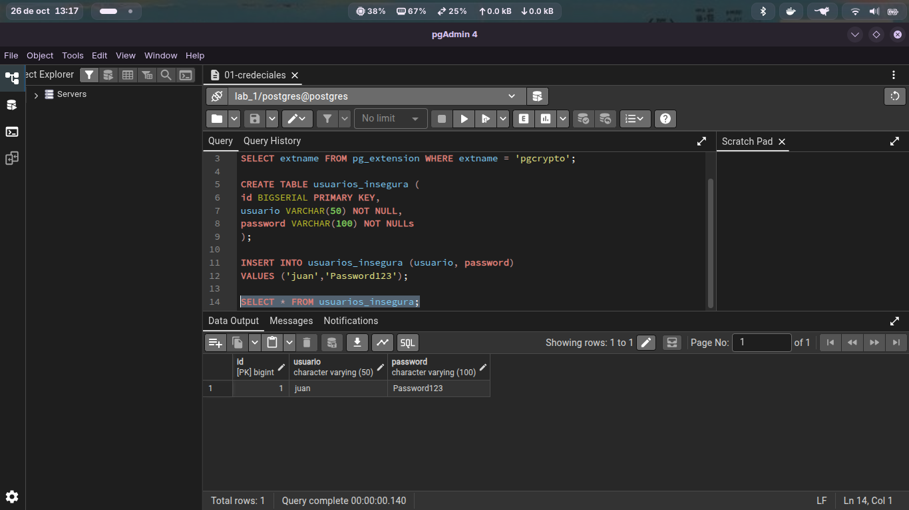
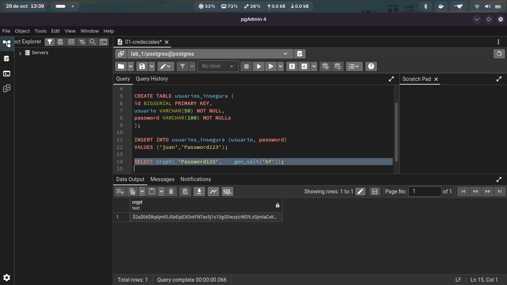
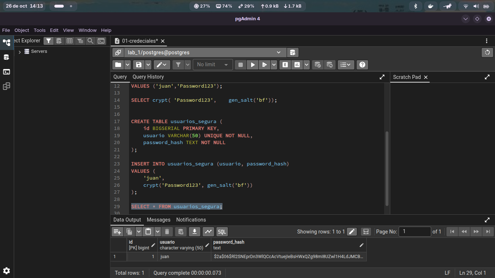
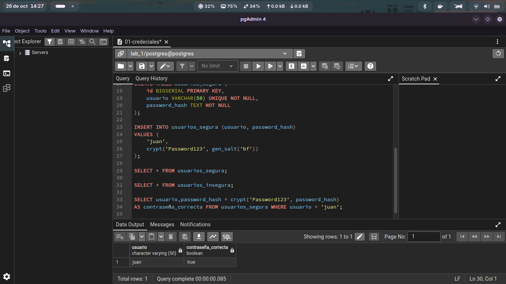
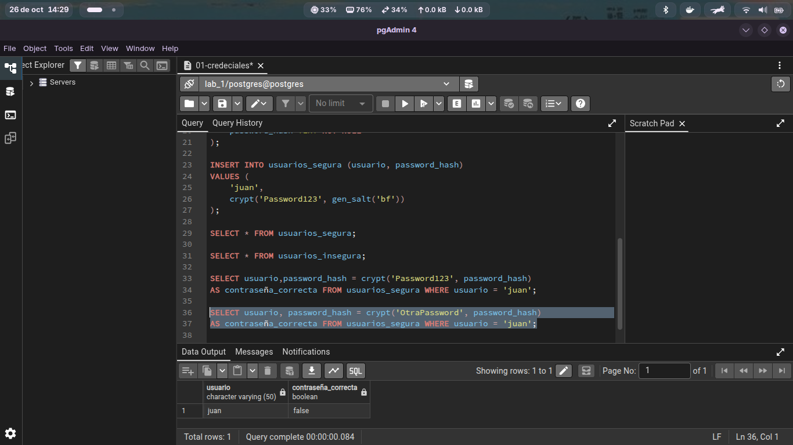

# Protección de credenciales

En esta sección realizaremos las siguientes acciones:

1. **Verificación de la extensión `pgcrypto`**
   - Comprobar si la extensión está disponible en la base de datos y verificar su funcionamiento.

2. **Creación de tabla**
   - Crear una nueva tabla donde los usuarios realizarán el inicio de sesión (*login*).

3. **Prueba y verificación**
   - Insertar datos de prueba.
   - Verificar la tabla y comprobar que los datos se hayan registrado correctamente.
   

> ⚠️ **Advertencia de Seguridad**
> 
> La consulta anterior permite observar directamente la contraseña, lo cual representa una **mala práctica** por dos razones principales:
>
> * **Acceso no autorizado:** Cualquier persona con acceso a la tabla puede obtener inmediatamente las credenciales.
> * **Riesgo de filtración:** Almacenar contraseñas en **texto claro (*plaintext*)** provoca que un incidente de seguridad o filtración en la base de datos exponga directamente las contraseñas de los usuarios.

### Implementación de `pgcrypto`

Para fines prácticos se utiliza la extensión **`pgcrypto`**. A continuación se muestra un ejemplo de su uso:

En esta parte ejecutamos de nuevo el codigo y podremos percatarnos que la serie de digitos cambian a cada acualizacion:

### Cuestionario de evaluación (`pgcrypto`)

1. **¿Son iguales?**
   **No, no son iguales** (los hashes generados son completamente diferentes, incluso si se utiliza la misma contraseña en varias ocasiones).

2. **Si no son iguales, ¿por qué?**
   Porque la función **`gen_salt()`** genera una sal (*salt*) aleatoria única cada vez que se ejecuta. Aunque la contraseña de entrada sea la misma, al combinarse con una sal distinta en cada ocasión, el valor hash final cambia totalmente.

3. **¿Qué función cumple `gen_salt()`?**
   Genera una cadena de datos aleatorios (*salt*) adaptada a un algoritmo específico (como `'bf'` para Blowfish/bcrypt). Sirve para:
   - Prevenir ataques con tablas arcoíris (*Rainbow Tables*).
   - Asegurar que dos usuarios con la misma contraseña tengan hashes guardados diferentes.

4. **¿Qué función cumple `crypt()`?**
   Aplica una función hash unidireccional al texto ingresado junto con la sal indicada. Se utiliza para:
   - **Registro:** Generar y guardar el hash seguro de la contraseña.
   - **Autenticación (Login):** Comparar la contraseña ingresada contra el hash guardado previamente.

5. **¿Esto es cifrado reversible?**
   **No, no es reversible.** Es una función resumen unidireccional (*one-way hash*). No existe forma de desencriptar o recuperar la contraseña original a partir del hash generado; solo se puede verificar volviendo a procesar la clave intentada.

### Almacenamiento seguro de credenciales

Aquí podemos observar la creación de la tabla donde se aplica un hash a la contraseña. Al utilizar la función `crypt()` junto con `gen_salt()`, la contraseña original en texto claro ya no queda expuesta ni visible en la base de datos, almacenándose únicamente el valor hash seguro.   

### Verificación de contraseña con respuesta booleana

En esta sección se realiza la comprobación de si la contraseña ingresada es correcta o incorrecta, devolviendo como resultado un valor booleano (`true` o `false`).

### verdadero

### falso

### Validación de contraseñas y conceptos de Hashing

1. **¿Qué resultado obtuviste con la contraseña correcta?**
   Un valor booleano **`true`** (o `t` en PostgreSQL), el cual confirma que la contraseña ingresada coincide exitosamente con el hash almacenado.

2. **¿Qué resultado obtuviste con la contraseña incorrecta?**
   Un valor booleano **`false`** (o `f` en PostgreSQL), lo que indica que la contraseña ingresada no corresponde a la cuenta.

3. **¿Por qué no es necesario recuperar la contraseña original?**
   Porque para verificar la identidad del usuario solo hace falta comprobar si la clave que ingresa durante el *login* produce el mismo hash al procesarse con la función `crypt()`. Si los resultados coinciden, se autentica la sesión sin necesidad de almacenar ni conocer la clave en texto claro.

4. **¿Por qué un hash no debe confundirse con cifrado?**
   * **Cifrado (Encriptación):** Es **bidireccional (reversible)**. Su función es ocultar datos que posteriormente pueden volver a convertirse a su estado original utilizando una clave de descifrado (*key*).
   * **Hash:** Es **unidireccional (irreversible)**. Transforma los datos en un resumen de longitud fija del cual es matemáticamente imposible recuperar la información original.

