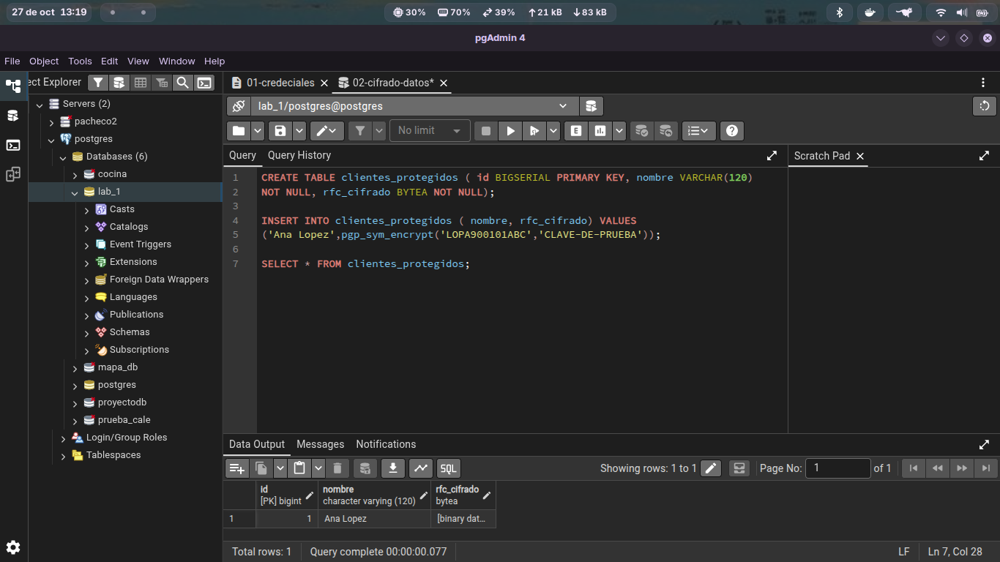
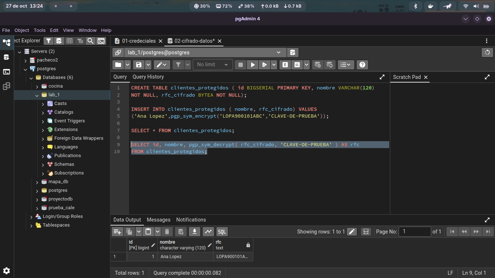

### Cifrado de información sensible

Tomaremos la información de la tabla del `lab_01` y crearemos una nueva tabla para agregar protección adicional. En este caso, utilizaremos los datos del **RFC**, ya que este tipo de información se considera sensible en contextos específicos.
insertamos nuevo usuario y le asignamos un rfc con la sig funcion `pgp_sym_encrypt('LOPA900101ABC','CLAVE-DE-PRUEBA')`

   

Para recuperar el dato se utiliza el sig. script 

`SELECT id, nombre, pgp_sym_decrypt( rfc_cifrado, CLAVE-DE-PRUEBA ) AS rfc
FROM clientes_protegidos;` 

### Comparativa de Cifrado y Hashing (`crypt` vs `pgp_sym_encrypt`)

1. **¿Qué diferencia existe entre `crypt()` y `pgp_sym_encrypt()`?**
   * **`crypt()`:** Es una función de **hashing unidireccional (irreversible)**. Se utiliza para proteger credenciales/contraseñas, convirtiendo el texto en un resumen del cual no se puede recuperar la información original.
   * **`pgp_sym_encrypt()`:** Es una función de **cifrado simétrico bidireccional (reversible)** basada en el estándar OpenPGP. Se utiliza para proteger datos sensibles (como el RFC) que posteriormente sí necesitan ser recuperados en texto claro mediante una clave secreta.

2. **¿Cuál de los dos mecanismos permite recuperar el dato original?**
   **`pgp_sym_encrypt()`**. Permite descifrar y recuperar la información original utilizando la función `pgp_sym_decrypt()` junto con la clave secreta adecuada.

3. **¿Qué ocurre si se utiliza una clave incorrecta?**
   La función `pgp_sym_decrypt()` no podrá descifrar los datos y PostgreSQL generará un error de seguridad (por ejemplo: `ERROR: Wrong key or corrupt data`), impidiendo el acceso al dato original.

4. **¿Qué problema de seguridad representa colocar la clave directamente en una consulta?**
   * **Exposición en logs:** La clave queda grabada en texto claro dentro de los registros del servidor (*logs* de PostgreSQL), en la vista de monitoreo `pg_stat_activity` y en el historial de comandos (`.psql_history`).
   * **Intercepción y fuga:** Cualquier persona con permisos para ver las consultas en ejecución o inspeccionar el tráfico de red (si no hay TLS/SSL) puede capturar la clave y desencriptar todos los datos almacenados.

