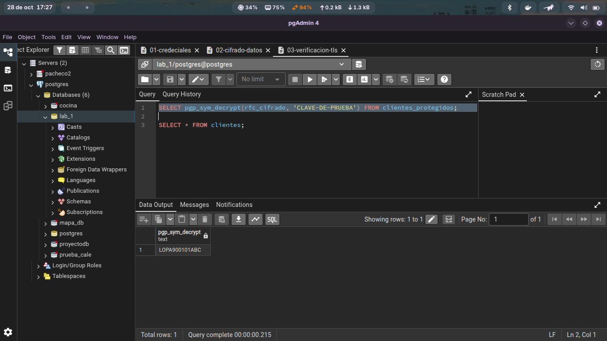

### Exposición de claves en consultas SQL

El siguiente ejemplo funciona técnicamente:

``SELECT pgp_sym_decrypt(rfc_cifrado, 'CLAVE-DE-PRUEBA') FROM clientes_protegidos;``

Pero existe un problema: la clave aparece dentro del código. Esto puede provocar exposición mediante:

Logs del servidor: La clave queda registrada en texto claro en los archivos de registro (logs) de PostgreSQL.

Historial de comandos: Queda almacenada en el historial de la terminal o cliente SQL (como .psql_history).

Vistas de monitoreo: Es visible para administradores a través de vistas del sistema como pg_stat_activity.

Tráfico de red: Si la conexión entre la aplicación y la base de datos no utiliza TLS/SSL, la clave viaja expuesta por la red.

### Análisis de Riesgo: Fuga de Claves en Repositorios Git

Si la clave utilizada fuera una clave real de producción y el archivo se publicara en un repositorio Git, se desencadenarían las siguientes consecuencias graves de seguridad:

* **Compromiso total de la confidencialidad:** Cualquier usuario o atacante con acceso al repositorio podría utilizar la clave para desencriptar inmediatamente todos los datos sensibles (como los RFCs) almacenados en la base de datos.
* **Permanencia en el historial de Git:** Aunque el archivo o la clave se eliminen en un *commit* posterior, el valor permanecerá accesible en el historial de versiones del repositorio a menos que se realice una reescritura y limpieza profunda de la historia (utilizando herramientas como `BFG Repo-Cleaner` o `git filter-repo`).
* **Explotación automatizada por bots:** Existen herramientas y *scrapers* maliciosos en constante ejecución que monitorean los *commits* de repositorios públicos en busca de llaves de cifrado, contraseñas y tokens para explotarlas en cuestión de segundos.
* **Incumplimiento normativo y sanciones:** Exponer datos sensibles de clientes representa una violación directa a las leyes de protección de datos (como la LFPDPPP en México o el GDPR en Europa), lo que deriva en pérdidas económicas, multas legales y daño a la reputación de la organización.

### Seguridad de Datos en Tránsito (Cliente - Servidor)

Cuando ejecutas una consulta como `SELECT * FROM clientes;`, la información se transfiere desde el servidor de PostgreSQL hacia la aplicación cliente a través de la red. Si esta conexión no está adecuadamente protegida, ocurren los siguientes riesgos:

* **Tránsito en texto claro:** Si la conexión no utiliza cifrado de transporte (TLS/SSL), tanto la consulta enviada como la respuesta con todos los datos resultantes viajan en texto plano por los paquetes de red (TCP/IP).
* **Intercepción por red (*Network Sniffing*):** Un atacante posicionado en la misma red local o mediante un ataque de intermediario (*Man-in-the-Middle* / MitM) puede capturar el tráfico utilizando herramientas como **Wireshark** o **`tcpdump`** y leer directamente el contenido de la tabla `clientes`.
* **Modificación de datos en vuelo:** Además de la pérdida de confidencialidad, la falta de cifrado permite que un atacante altere los datos o las consultas en tránsito sin que el cliente o el servidor lo detecten.

---

#### ¿Qué sucede con la información mientras viaja entre el cliente y PostgreSQL?¿Cómo se soluciona?

Para proteger la información mientras viaja, es necesario implementar **cifrado en tránsito** en PostgreSQL:
1. **Activar TLS/SSL en el servidor:** Configurar `ssl = on` en `postgresql.conf` con certificados válidos.
2. **Forzar conexiones seguras:** Configurar `pg_hba.conf` utilizando reglas `hostssl` para rechazar cualquier conexión que no use cifrado.