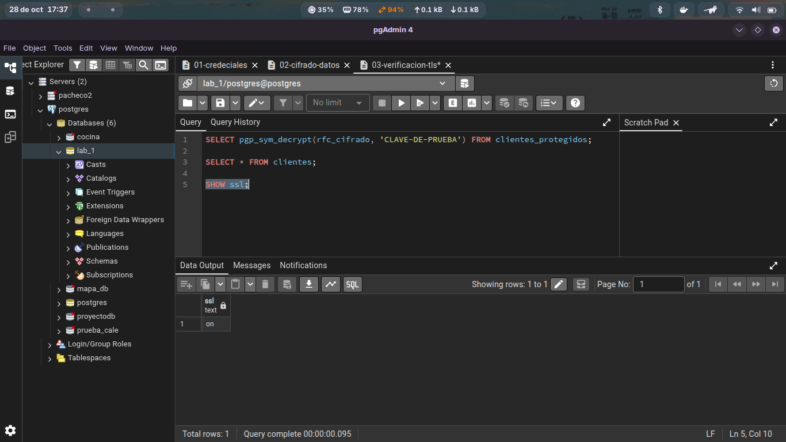
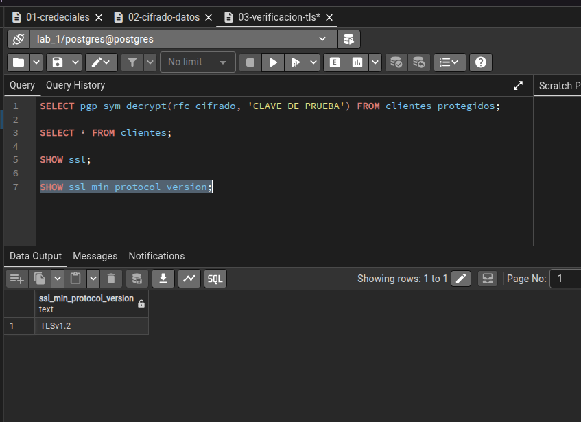
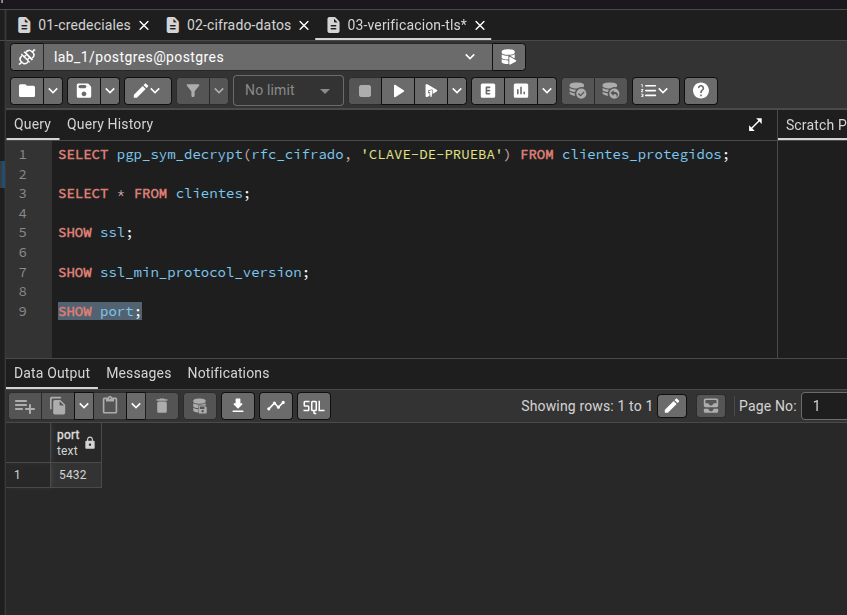
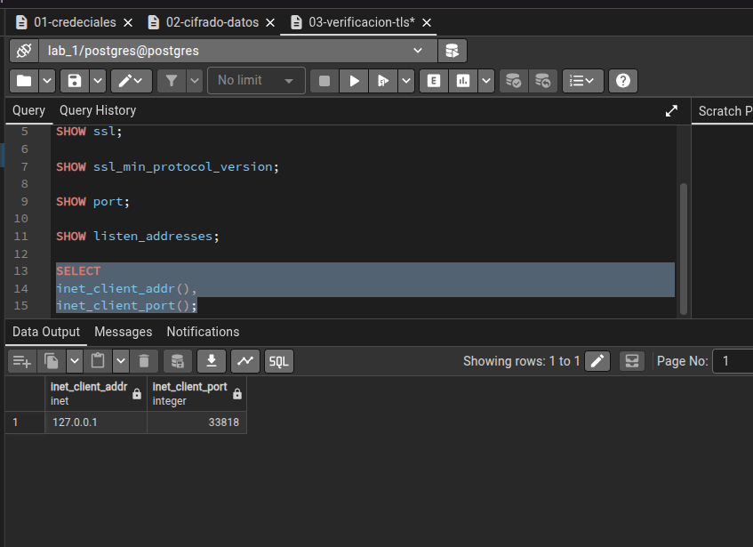
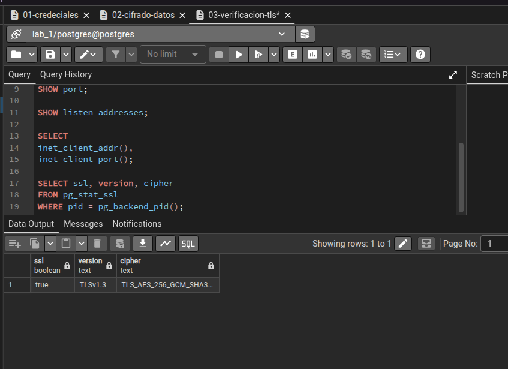
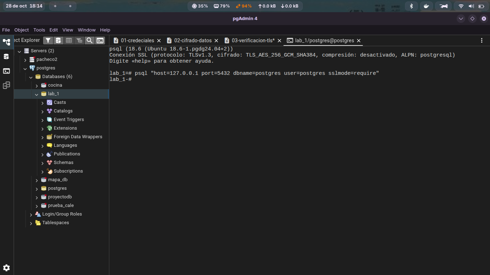

# Verificar el estado de TLS en PostgreSQL

### En esta parte consultaremo la activida de el ssl:

### Aqui podemos ver la version de el Tls

### Chekeo de puerto

### verificar la conexion actual

### verificar si la secion actual utiliza Tls

### Cuestionario: Verificación de Conexión TLS en PostgreSQL

1. **¿La conexión actual utiliza TLS?**
   **Sí.** En la consulta a la vista `pg_stat_ssl`, la columna `ssl` devuelve el valor booleano **`true`**. Esto confirma que la sesión actual entre el cliente (`127.0.0.1:33818`) y el servidor PostgreSQL cuenta con un canal de comunicación cifrado.

2. **¿Qué versión de TLS se está utilizando?**
   Se está utilizando **TLSv1.3**. Esta es la versión más reciente, eficiente y segura del protocolo de seguridad de la capa de transporte (TLS), la cual elimina algoritmos criptográficos obsoletos y reduce la latencia en el establecimiento de la conexión (*handshake*).

3. **¿Qué algoritmo de cifrado aparece?**
   Aparece el conjunto de cifrado (*cipher suite*) **`TLS_AES_256_GCM_SHA384`**. Este algoritmo utiliza:
   * **AES-256-GCM:** Cifrado simétrico de bloque de 256 bits en modo Galois/Counter Mode (GCM), que proporciona cifrado autenticado e integridad de datos.
   * **SHA-384:** Función hash criptográfica para la verificación de integridad de los datos transmitidos.

4. **¿Qué diferencia existe entre una conexión protegida con TLS y una conexión sin TLS?**
   * **Con TLS (`ssl = true`):** Todo el tráfico que viaja desde el cliente (`127.0.0.1`) hacia el servidor viaja cifrado con la suite `TLS_AES_256_GCM_SHA384`. Garantiza la **confidencialidad** e **integridad** de las consultas y los datos retornados, impidiendo que un atacante capture paquetes en la red (*sniffing*) o realice ataques de intermediario (*Man-in-the-Middle*).
   * **Sin TLS (`ssl = false`):** La comunicación se realiza en texto plano. Cualquier usuario o herramienta de monitoreo en la red (como Wireshark) puede interceptar y leer las credenciales, consultas SQL ejecutadas y resultados de las tablas sin ninguna restricción.

   ### Conexión desde la Terminal mediante `psql` forzando TLS

Para verificar la conexión segura utilizando el cliente de línea de comandos `psql`, se utiliza la siguiente cadena de conexión incluyendo el parámetro `sslmode=require`:

``psql "host=127.0.0.1 port=5432 dbname=postgres user=postgres sslmode=require"``

PostgreSQL proporciona diferentes modos de conexión TLS.
Los más importantes para esta práctica son:
disable
prefer
require
verify-ca
verify-full
No todos proporcionan el mismo nivel de verificación.
sslmode=require
Solicita una conexión TLS, pero no verifica completamente la identidad del servidor.
sslmode=verify-ca
Además de utilizar TLS, verifica el certificado contra una autoridad certificadora de confianza.
sslmode=verify-full
Además de validar la autoridad certificadora, verifica que el nombre del servidor coincida con
el certificado.
En un entorno real, cuando se requiere una validación fuerte de identidad, verify-full es el
modelo que debes comprender.
